# 成绩单透镜 使用说明书

适用版本：**v1.9.8**　·　适用系统：Windows 10 / 11（64 位）
文档版本：2026-11-18　·　适用对象：在校学生、班委、辅导员

---

## 开篇：5 分钟快速开始

第一次打开成绩单透镜，照着下面五步走，就能看到自己的成绩分析：

1. **安装或解压**。双击安装包，一直点「下一步」；或者把便携版 exe 放到一个固定文件夹（例如 `D:\Tools\成绩单透镜\`）。
2. **注册一个本机账号**。打开程序 → 点「去注册」→ 填账号、密码、确认密码 → 点「注册」。
3. **⭐ 保存找回码**。注册成功后会弹出一个窗口，里面是一串 24 位的「找回码」。**把它抄在纸上或存进密码管理器**——这串码只显示这一次，忘了密码时它是唯一能救回成绩的东西。
4. **导入成绩表**。进入「智育分析」→ 点「导入成绩表」→ 选择学校教务系统导出的 Excel → 填班级号 → 选成绩范围（例如「大一上」）→ 在确认窗口里核对课程和学分 → 点「确认」。
5. **看结果**。表格里每个人一行：姓名、学号、加权均分、红标原因。点一行右侧的「侧写」，可以看这个人的学期画像。

> 💡 提示：程序所有数据都只存在你自己的电脑上（`%LOCALAPPDATA%\SGMS\`），不上传、不联网同步。装完可以先随便导一份**假表**试试手感，确认会用了再导真表。

---

## 第 1 章 认识成绩单透镜

### 1.1 它能帮你做什么

成绩单透镜是一个**只看成绩单**的桌面小工具。它把教务系统导出的Excel 成绩表读进来，在本地算好下面这些数：

- **学分加权平均分（智育加权）**：按学分加权，不按门数平均；
- **三种计算口径**：全部课程 / 必修+限选 / 仅必修，随时切换；
- **挂科与缺考预警**：红色标出哪门挂了、哪门缺考；
- **成长档案**：把每个学期的成绩攒成时间轴，看趋势；
- **奖学金测算**：按班级、学年算综合成绩和排名；
- **GPA 换算**：六套常用方案，也可以自己定义；
- **本地 AI（可选）**：装好本地模型后，生成学业画像的文字初稿。

### 1.2 它不做什么

- **不上传任何成绩**。没有云端账号、没有服务器同步。
- **不替你改成绩、不改教务系统数据**。它只是把表读进来看。
- **不是官方成绩证明**。一切以学校教务系统为准。
- **不保证识别所有学校的表头**。每个学校表格格式不同，识别不了时程序会告诉你，而不是瞎猜。

### 1.3 界面总览

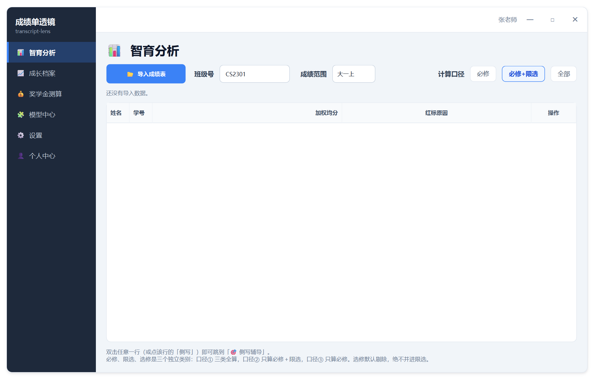

*图 1-1　主界面：左侧六项导航，右侧是当前页面。顶部显示当前账号。*

左侧导航固定六项，顺序不变：

| 导航 | 你在这里做什么 |
|---|---|
| 📊 智育分析 | 导入成绩表，看加权均分和挂科预警 |
| 📈 成长档案 | 一个学生的历学期成绩、趋势、侧写 |
| 💰 奖学金测算 | 按班级算综合成绩、排名、奖项 |
| 🧩 模型中心 | 下载本地 AI 推理核心和模型 |
| ⚙️ 设置 | 导出、GPA 方案、更新、删除成绩库 |
| 👤 个人中心 | 改密码、重新生成找回码 |

### ✅ 检查点

- 左侧能看到六项导航，点哪一项右侧就换哪一页；
- 顶栏显示的是你注册时的账号名；
- 右下角、设置页「更新」卡片里显示的版本号，应当与安装包上的版本一致。

**本章要点**

1. 这是一个纯本地、只读成绩的桌面工具。
2. 六项导航顺序固定，功能各管一件事。
3. 它不是官方成绩证明，最终以教务系统为准。

---

## 第 2 章 安装与启动

### 2.1 两种形态，二选一

| 形态 | 适合谁 | 有什么不同 |
|---|---|---|
| **安装向导**（推荐） | 大多数同学 | 装到 `%LOCALAPPDATA%\Programs\Transcript Lens`，**不需要管理员权限**，开始菜单和桌面会有快捷方式 |
| **便携版 exe** | 机房、共用电脑、U 盘 | 单个 exe，双击即用，不写注册表；换电脑时把 exe 和 `%LOCALAPPDATA%\SGMS\` 一起带走即可 |

### 2.2 安装步骤

1. 双击 `成绩单透镜v1.9.8-安装向导.exe`。
2. 选安装位置（默认即可），点「下一步」。
3. 等待进度条走完，点「完成」——程序会自动启动。
4. 首次启动可能稍慢（系统在做安全扫描），第二次起就快了。

> ⚠️ 注意：Windows Defender 或安全软件可能对**新下载的** exe 弹「未知发布者」提示。这是没有代码签名证书时的正常现象，确认文件来自你自己的下载后选择「仍要运行」。**不要**为了运行程序关闭安全软件。

### 2.3 卸载

开始菜单 →「成绩单透镜」文件夹 →「卸载 成绩单透镜」，或「设置 → 应用」里找到它卸载。

> ⚠️ 注意：卸载**不会**删除 `%LOCALAPPDATA%\SGMS\` 里的成绩数据。想彻底清干净，请在程序内「设置 → 删除成绩库」先删库，再卸载。

### 2.4 从旧版本升级

如果装过 1.9.7 或更早的版本：

- 安装新版会**覆盖**旧版；
- 旧版留下的开始菜单快捷方式（旧名字）会被安装包清理掉，不会出现两个入口；
- 数据目录保留，登录后成绩还在；
- 首次打开旧数据时，程序会自动做一次数据升级（会先自动备份）。

### ✅ 检查点

- 开始菜单里只有**一个**「成绩单透镜」；
- 设置页「更新」卡片显示 `v1.9.8`；
- 登录后原来导入过的班级仍在奖学金页的下拉框里。

**本章要点**

1. 安装向导不需要管理员权限；便携版单文件即用。
2. 卸载不删数据，删数据要用程序内的「删除成绩库」。
3. 升级覆盖安装，数据自动升级并备份。

---

## 第 3 章 账号：注册、登录、找回

成绩单透镜的账号**只存在这台电脑上**，没有云端账号。密码用来加密你的成绩库；丢了密码，就只能靠找回码。

### 3.1 登录

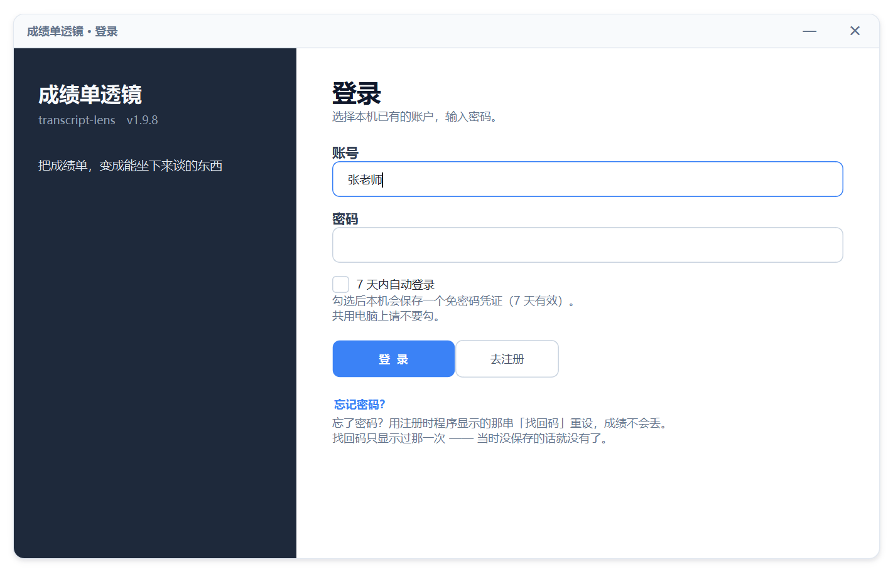

*图 3-1　登录窗口：账号 + 密码；下方「忘记密码？」是找回入口。*

1. 在「账号」里选或输入你的账号名；
2. 输入密码；
3. 点「登录」。

勾选「7 天内自动登录」后，下次打开会直接进主界面（适合只用自己电脑的同学）。**共用电脑请不要勾**。

### 3.2 注册

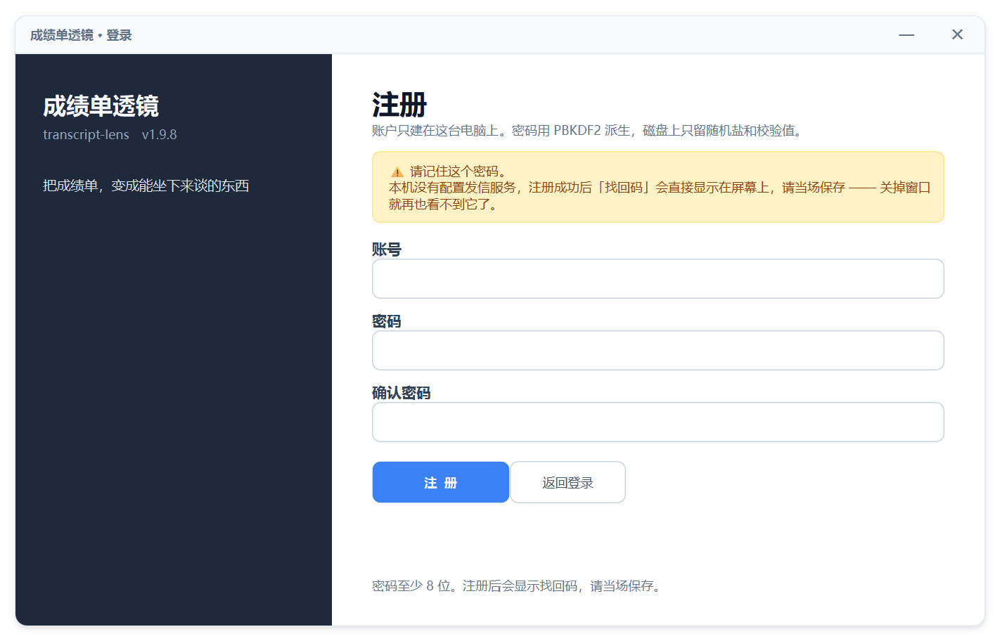

*图 3-2　注册页。本机没有配置发信服务时，邮箱与验证码两栏会自动隐藏。*

填三项即可：**账号**（≥8 位密码）、**密码**、**确认密码**。

注册分两种情况，程序会自动判断：

- **本机配置了发信服务**：还需要填邮箱、点「发送验证码」、输入 6 位验证码。找回码会同时显示在屏幕上并寄到你邮箱。
- **本机没有配置发信服务**（绝大多数个人用户）：邮箱和验证码两栏直接隐藏，注册成功后**当场显示找回码**。

### 3.3 ⭐ 找回码（最重要的一步）

注册成功后，会弹出类似下面的窗口：

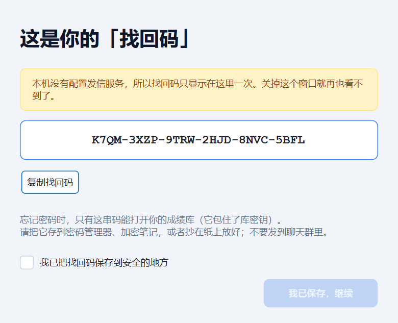

*图 3-3　找回码窗口：需要勾选「我已把找回码保存到安全的地方」才能继续。*

**这串 24 位的码是你唯一的第二把钥匙。** 请立刻做下面任意一件事：

- 抄在纸质笔记本上；
- 存进密码管理器；
- 打印出来夹在书里。

窗口里点「复制找回码」可以复制到剪贴板；勾选确认后点「我已保存，继续」。如果你直接关窗口，程序会再问你一次「确定要丢弃吗」。

> ⚠️ 注意：找回码**只显示这一次**。程序不会把它存成明文，也不会再寄一次。没保存 = 永久丢失，忘密码时成绩将无法恢复。

### 3.4 忘记密码

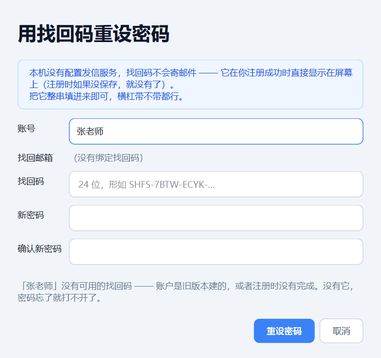

*图 3-4　「重置密码」对话框：账号 + 找回码 + 新密码。*

1. 在登录窗口点「忘记密码？」；
2. 输入**账号**；
3. 输入**注册时保存的找回码**（区分大小写，中间的短横线可以保留）；
4. 设置新密码，点「重置密码」。

重置成功后，**成绩一条都不会丢**——找回码解开的是同一把库密钥，只是换了个包裹它的密码。

### 3.5 个人中心：改密码、重新生成找回码

「个人中心」可以：

- **修改密码**：需要旧密码 + 新密码；
- **重新生成找回码**：需要当前密码，生成后同样只显示一次。旧找回码随即失效。

> 💡 提示：如果你怀疑找回码被同学看到过，去个人中心重新生成一次。

### ✅ 检查点

- 注册完成后你能找到那串 24 位码（纸质或密码管理器都行）；
- 用新密码能登录，用旧密码登录会提示「密码不正确」；
- 登录后成绩还在（重置密码不会清库）。

**本章要点**

1. 账号只在本机，密码加密成绩库。
2. 找回码只显示一次，必须当场保存。
3. 忘密码 = 账号 + 找回码 + 新密码，成绩不丢。

---

## 第 4 章 导入成绩表

### 4.1 支持的表格

- `.xlsx` / `.xlsm`（新版 Excel）；
- `.xls`（老版 Excel，程序按文件内容自动选读取引擎，不看扩展名）；
- `.csv`（逗号分隔）。

表格要求：

- 有一行表头，包含「姓名」或「学号」；
- 其余列是课程名，最好带上学分和类别，例如 `高等数学(5学分)必修`、`专业英语(2学分)限选`；
- 每行一个学生。

> 💡 提示：直接从教务系统「导出成绩单」得到的表，多数能直接识别。识别不出来时，程序会把前几条警告列出来，照着改表头即可。

### 4.2 导入五步

1. 进入「智育分析」；
2. 确认顶部「班级号」——**必填**，只能是字母、数字和短横线（1~32 位，例如 `CS2301`）；
3. 选「成绩范围」（大一上 → 大四下，共 8 个）；
4. 点「导入成绩表」，选文件；
5. 在确认窗口里核对课程与学分，点确认。

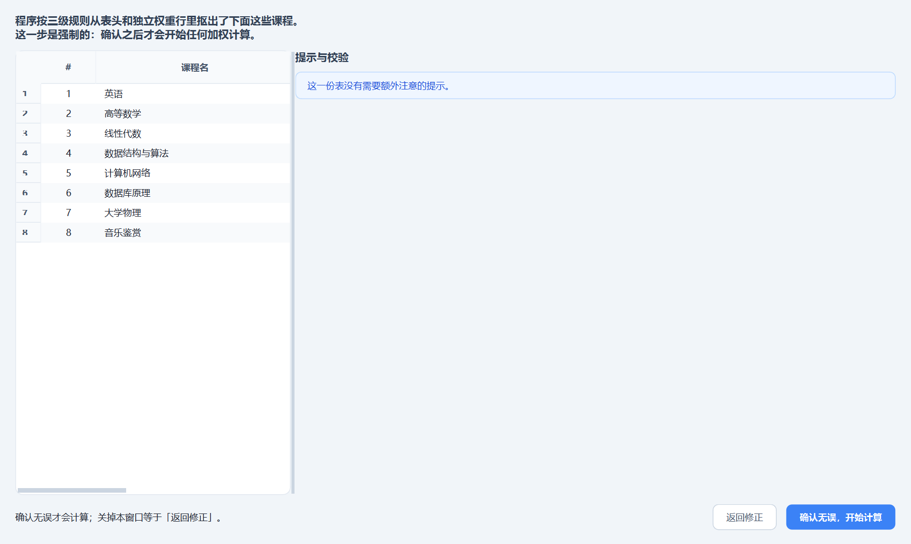

*图 4-1　课程确认窗口：左边是识别出的课程与学分，右边是提示和锚点校验结果。*

### 4.3 为什么要人工确认学分

学分决定加权。程序会把「从表头抠出来的学分」原样摆给你看，**你不点确认，它绝不开始算**。这是刻意的：宁可多点一下，也不要拿一个错学分算出一个错的加权分。

- 学分不对：取消导入，回 Excel 把学分补在课程名括号里，再导一次；
- 少了一门课：多半是那门课的列名没带学分/类别，或者表头行没识别对。

### 4.4 分数超过 100 怎么办

如果表里有 >100 的分数（例如百分制加成后的「101」），程序会弹窗提示。原因是：**超过 100 的分数会被排除在加权分母之外**，但仍算「这门考过」。请先核对原表，确认是不是录错了。

### 4.5 同一学期重复导入

如果这个学生、这个学期已经有过成绩，程序会问你怎么处理：

- **覆盖**：用新表的数据替换旧记录；
- **跳过**：保留旧记录，这一行不导入；
- **全部覆盖 / 全部跳过**：对这一批所有冲突都照此办理。

导入结束会告诉你「覆盖 N 条 / 新增 M 条 / 跳过 K 条」。

### 4.6 导入后的样子

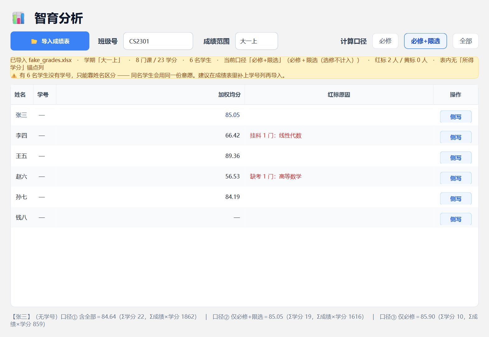

*图 4-2　导入完成后：顶部状态行给出班级、学期、门数、总学分、当前口径、红标人数。*

表格各列：

| 列 | 含义 |
|---|---|
| 姓名 / 学号 | 学生身份。**学号为空时会提示同名风险** |
| 加权均分 | 当前口径下的学分加权平均分 |
| 红标原因 | 挂科（<60）、缺考（记 0）逐门列出 |
| 操作 | 「侧写」——跳到这个人的学业画像 |

表格下方那行小字，是**当前选中同学**三档口径的完整算式（Σ学分、Σ成绩×学分），方便你核对。

**本章要点**

1. 班级号必填，格式是字母数字短横线。
2. 学分必须人工确认，没确认不算。
3. 空成绩 = 没选这门课，不进分母；0 分 = 缺考，进分母。
4. 同学期重复导入会问你覆盖还是跳过。

---

## 第 5 章 看懂智育分析

### 5.1 三种计算口径

屏幕右上角三个按钮，同一时刻只有一档生效：

| 口径 | 算什么 | 什么时候用 |
|---|---|---|
| 必修 | 只算必修课 | 看专业课硬实力 |
| **必修+限选**（默认） | 必修 + 限选 | 学校评奖学金的常用口径 |
| 全部 | 必修 + 限选 + 选修 + 未标类别 | 看总盘子 |

> ⚠️ 注意：**选修课默认剔除**，这是刻意的。必修、限选、选修是三个独立类别，程序不会把选修偷偷算进限选。

切换口径时，三件事一起变：可见的那一列、红标判定（分母变了，挂科/缺考的基础也变了）、推给侧写页的名单。

### 5.2 红标怎么读

- **红色**：挂科（成绩 < 60）或缺考（记 0 分）；
- **黄色**：接近警戒线的科目；
- 没有标记 = 这一档口径下没有需要提醒的科目。

### 5.3 表头的「加权均分」

三档口径的列头文字**故意完全相同**，都叫「加权均分」。为什么？因为这一列装的永远是同一种东西——学分加权平均分；变的是「算了哪几类课」。当前算的是哪一档，看右上角按钮和状态行。

### 5.4 侧写按钮

点某一行右侧的「侧写」，会跳到成长档案页并打开这个学生的画像。也可以双击整行。

**本章要点**

1. 三档口径互斥，默认「必修+限选」。
2. 选修默认不算，红标随口径重算。
3. 三列同名「加权均分」是设计，不是 bug。

---

## 第 6 章 成长档案

### 6.1 学生名单

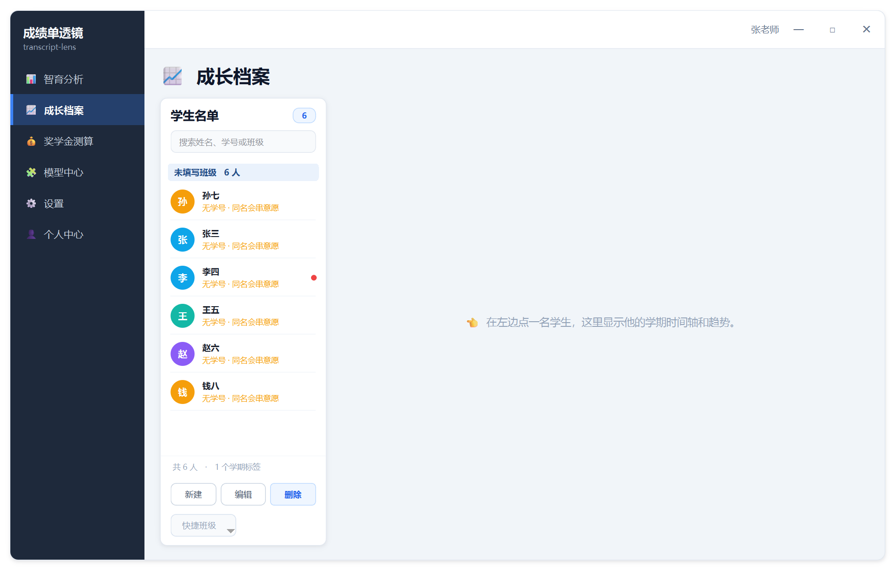

*图 6-1　成长档案页：左侧学生名单按班级分组，右侧显示选中学生的详情。*

- 名单来自**导入过的成绩**，不另建第二份名单；
- 默认不显示已归档的学生；在搜索框输入「已归档」才看得到；
- 搜索支持姓名、学号、班级；
- 红点表示这个人在当前口径下有挂科/缺考。

### 6.2 学生详情

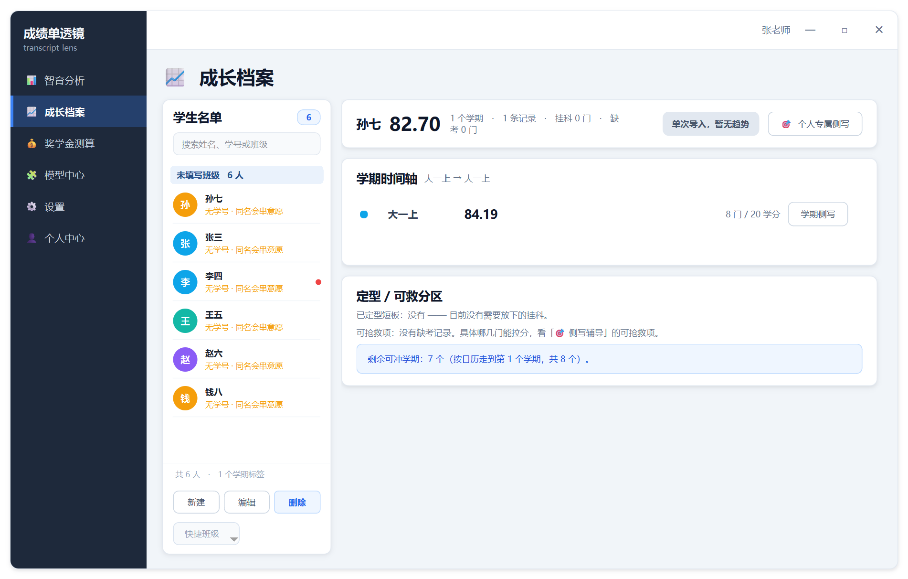

*图 6-2　学生详情：总均分、学期时间轴、定型/可救分区。*

- 顶部大字是这个人的**累计均分**（算术平均，标签会写清楚）；
- 「学期时间轴」每个点是一个学期，点右侧「学期侧写」进入二级页面；
- 「定型 / 可救分区」按挂科情况自动分。

### 6.3 学期侧写

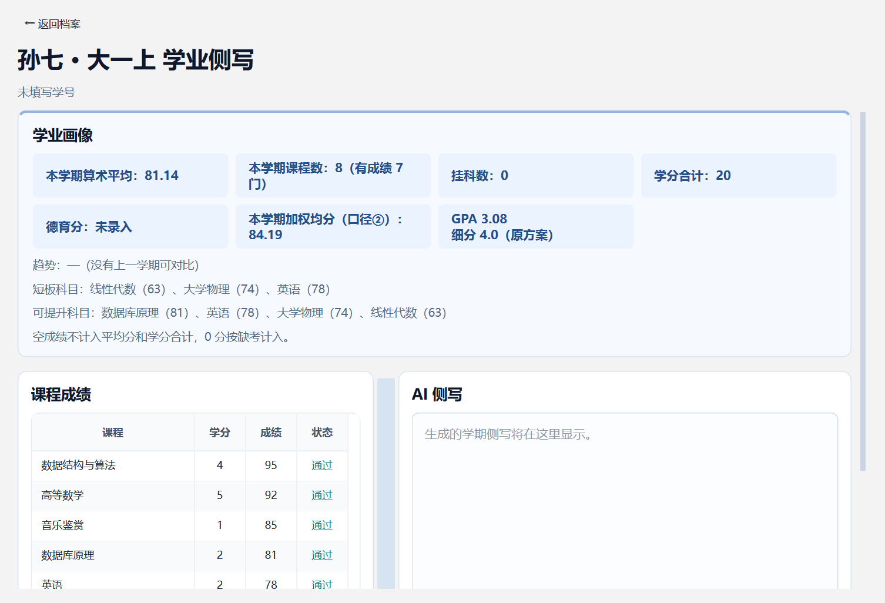

*图 6-3　学期侧写：本学期各项指标、课程成绩、AI 侧写区。*

上半部分是数字（算术平均、加权均分、GPA、学分合计、挂科数），下半部分左列是课程明细，右列是 AI 侧写区。

> ⚠️ 注意：**学期均分是算术平均**（门与门等权），加权均分才是按学分算。两个数不一样是正常的。

### 6.4 改学号、删除、归档

- **改学号**：编辑学生信息 → 改学号 → 保存。程序会把成绩历史、侧写、聊天记录、德育分键一起迁过去（失败只提示，不中断）。
- **删除学生**：二选一——彻底删除（先清关联数据）或归档隐藏（数据全留，搜索「已归档」可见）。

### 6.5 AI 辅导（可选）

装了本地模型后，详情页的 AI 区可以生成画像初稿。**没装模型时这里只会给中文原因和「打开模型中心」按钮**，不会静默失败。

**本章要点**

1. 名单只来自导入的成绩，没有第二份。
2. 学期均分是算术平均，加权均分按学分。
3. 改学号会全量迁移关联数据；删除二选一。

---

## 第 7 章 奖学金测算

### 7.1 公式先看清

```
最终成绩 = 学年智育加权（必修 + 限选）× 0.7 + 德育分 × 0.3
```

- 学年智育**固定用必修+限选**口径（不受智育分析页按钮影响）；
- 只在同班级、同学年内排名；
- 只有大一到大四参与。

### 7.2 选班级与学年

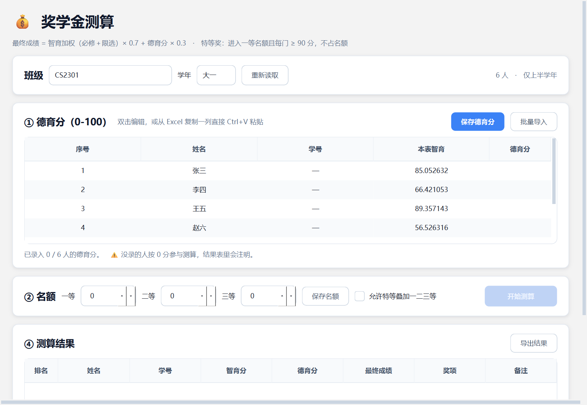

*图 7-1　奖学金页：班级与学年、德育分表、名额、测算结果。*

班级下拉框来自你导入过的班级快照；学年选「大一」到「大四」。选好后页面会自动带出这个班这个学年的名单。

### 7.3 录德育分

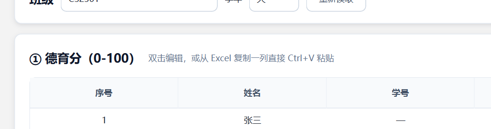

*图 7-2　德育分表：双击单元格录入，或从 Excel 复制一列直接粘贴。*

三种录法：

1. 双击单元格直接输，输完点「保存德育分」；
2. 在 Excel 里选中一列德育分 → Ctrl+C → 回到表格第一格 → Ctrl+V；
3. 点「批量导入」，选班委做的《品行诚信与素质测评表》，程序会先预览、报错行单独列出，再让你确认写入。

> ⚠️ 注意：**没录德育分 ≠ 0 分**。没录的人按 0 参与测算，但结果表里会备注「德育分未录入，按 0 计」，格子是空白而不是 0。

### 7.4 设名额并测算

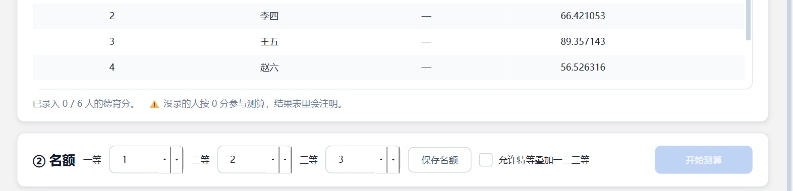

*图 7-3　名额：一等/二等/三等各几名，勾选是否允许特等叠加。*

1. 填一、二、三等奖名额，点「保存名额」；
2. 需要的话勾「允许特等叠加一二三等」；
3. 点「开始测算」。

**特等奖**规则：最终成绩进入一等名额范围，**并且**每门已考课程原始成绩都 ≥90。

- 特等**不占名额**：拿特等的人移出名额池，后面的人往前补；
- 默认**不叠加**；勾了叠加，表格显示「特等+一等」，统计里两边都数；
- 只检查「真考了的课」：没选的课不参与，缺考（0 分）算考了，拿不到特等。

### 7.5 导出结果

测算结果右上角「导出结果」可以导出 Excel，给班委做表用。

**本章要点**

1. 最终成绩 = 学年智育（必修+限选）×0.7 + 德育 ×0.3。
2. 德育没录按 0 算，但必须备注。
3. 特等不占名额，默认不叠加。

---

## 第 8 章 GPA 换算

### 8.1 在哪里改

「设置 → GPA 换算规则」：「当前方案」下拉框选方案，右边「编辑」「删除」。


*图 8-1　设置页：导出、GPA 换算规则、更新、删除成绩库四张卡片。*

### 8.2 内置方案

程序内置六套常用方案：细分 4.0（原方案）、标准 4.0、标准 5.0、4.3 制、WES、五级制。默认是「细分 4.0（原方案）」。

### 8.3 自定义方案

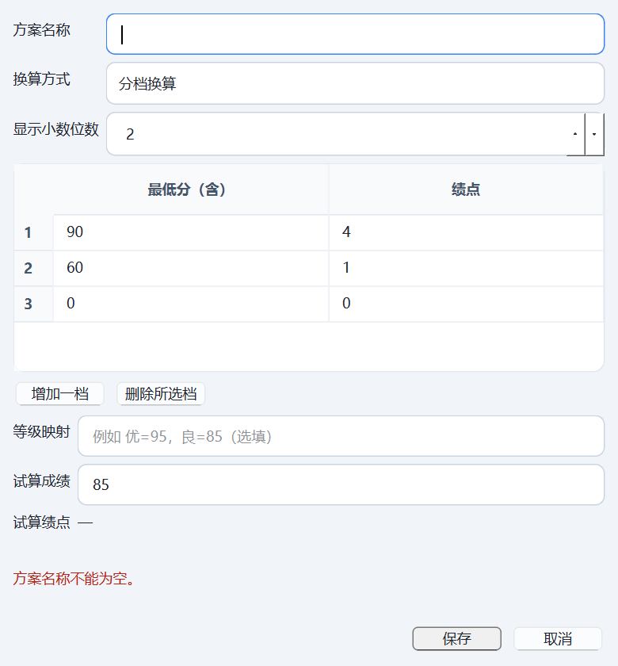

*图 8-2　编辑 GPA 方案：分档或线性换算、小数位数、等级映射、试算。*

- **换算方式**：分档（每档一个最低分和一个绩点）或线性；
- **显示小数位数**：0~6 位；
- **等级映射**：把「优 / 良 / 中 / 及格」映射成分数，例如 `优=95, 良=85`；
- **试算**：输一个成绩，立刻看到会换算出多少绩点。

校验规则（不满足会提示，存不下去）：

- 至少 2 档；
- 最低分从高到低排列；
- 最后一档最低分必须是 0；
- 绩点随分数升高不降低；
- 绩点在 0~5 之间。

> 💡 提示：GPA 只影响「显示」，**不影响**加权均分和奖学金测算。改 GPA 方案不会改任何原始成绩。

**本章要点**

1. GPA 方案是显示层的事，不动原始数据和加权。
2. 自定义支持分档和线性，最多 10 个方案。
3. 改完可以在学期侧写里核对。

---

## 第 9 章 模型中心与本地 AI

### 9.1 它是什么

「模型中心」用来下载两样东西：

1. **本地 AI 推理核心**（一次性的运行环境，装进程序私有目录）；
2. **模型文件**（`.gguf`，1~3 GB，按需下载）。

装好之后，学期侧写页的「AI 侧写」和详情页的「AI 辅导」才能用。**不装也能正常用全部成绩功能**。

### 9.2 下载推理核心

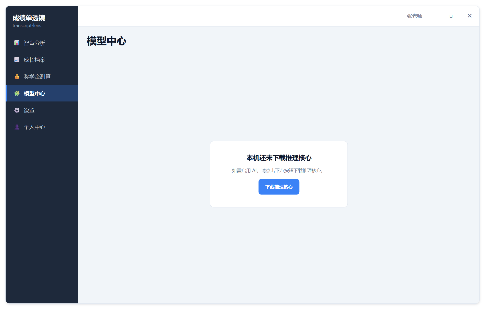

*图 9-1　模型中心空状态：先下载推理核心，再挑模型。*

1. 进入「模型中心」，点「下载推理核心」；
2. 程序会借用本机已安装的 Python 和 pip，把依赖装到 `%LOCALAPPDATA%\SGMS\runtime\site`；
3. 装好后卡片会变成「已就绪」。

> ⚠️ 注意：如果本机没有 Python，程序会给出**完整命令**和「复制命令」按钮，让你手动装。它绝不会在后台偷偷下载。

### 9.3 挑模型

模型列表按「负载」分三档：

| 标记 | 含义 |
|---|---|
| 🟢 轻松 | 内存够，跑得动，默认勾选 |
| 🟡 勉强 | 内存偏紧，能跑但慢 |
| 🔴 困难 | 内存不够，整行不可选（不是「不勾」，是根本点不动） |

- 默认只勾 🟢；
- 内存探不到的机器**一律放行**（宁可让你试，也不误判）；
- 下载失败会重试一次，仍失败就给「复制链接」手动下载。

### 9.4 隐私

AI 推理**全部在本机完成**，不连云端。当前版本不包含任何云端大模型调用。

**本章要点**

1. 推理核心 + 模型都是可选的，不影响成绩功能。
2. 默认只勾「轻松」档；困难档不可选。
3. AI 全本地运行，不上传成绩。

---

## 第 10 章 设置

设置页四张卡片（见图 8-1）：

### 10.1 导出

- **含姓名版**：完整数据，自己做备份用；
- **脱敏版**：去掉姓名、学号，给老师或同学看时不泄露隐私。

导出的是 Excel，可以自己再加工。

### 10.2 GPA 换算规则

见第 8 章。

### 10.3 更新

- 显示当前版本号；
- 「检查更新」**只有你点的时候**才联网，一次只读一个版本号；
- 有新版会告诉你版本号和下载入口，**绝不自动下载、绝不偷偷替换**。

### 10.4 删除成绩库

> ⚠️ 注意：这是**不可恢复**的操作。

- 勾「同时删除侧写与档案快照」会连档案一起删；
- 点「删除成绩库」后要**确认两次**；
- 删完各页面会自动刷新，不用重启。

**本章要点**

1. 导出分含姓名版和脱敏版。
2. 检查更新只在点击时联网。
3. 删除成绩库不可恢复，删前先导出备份。

---

## 第 11 章 更新与升级

### 11.1 检查更新

设置 → 更新 →「检查更新」。可能出现四种结果：

| 结果 | 意思 |
|---|---|
| 发现新版本 vX | 有新版，给下载入口 |
| 当前已是最新版本 | 不用动 |
| 还没有发布任何发行版 | 仓库还没发正式版 |
| 检查失败，请手动访问仓库 | 网络不通，去仓库页手动下 |

### 11.2 同一个版本号装过两套包

历史版本里 1.9.7 发过「原版」和「GPA 版」两个包，版本号相同。**同版本号不会提示更新**。如果你不确定装的是哪套：设置页看版本号，再对一下安装包文件名；需要换就手动覆盖安装。

### 11.3 升级步骤

1. 先「设置 → 导出」备份一份（含姓名版）；
2. 关闭程序；
3. 运行新安装包，覆盖安装；
4. 打开，登录，确认版本号和成绩都在。

> 💡 提示：数据目录是独立的，覆盖安装不会动成绩；但仍建议升级前导出一次，养成习惯。

**本章要点**

1. 更新只在点击时发生，不自动下载。
2. 同版本号不提示更新。
3. 升级前先导出备份。

---

## 第 12 章 数据与安全

### 12.1 数据存在哪

```
%LOCALAPPDATA%\SGMS\
├─ users.json        账号索引（不含密码明文）
├─ app.salt          加密用的盐
├─ u_xxxxxxxx\       每个账号的密文数据
│   ├─ grades.enc
│   ├─ grade_history.json.enc
│   ├─ student_profiles.json.enc
│   └─ ...
├─ models\           本地模型（可选，可重下）
├─ runtime\site\     推理核心（可选，可重装）
└─ logs\app.log      运行日志（排查问题用）
```

### 12.2 加密到什么程度

- 成绩在磁盘上**只有密文**；
- 密码不落盘，只保存「用密码包起来的库密钥」；
- 忘记密码时，唯一的解法是找回码（它包着同一把库密钥）；
- 两把钥匙都丢，数据无法恢复——没有后门，这也是它安全的原因。

### 12.3 备份与恢复

- 最省事：设置 → 导出 → 含姓名版，存一份 Excel；
- 完整备份：把整个 `%LOCALAPPDATA%\SGMS\` 复制到别处（登录状态下复制最稳妥）；
- 恢复：把目录拷回原位，用原来的密码登录。

### 12.4 日志与错误上报

- 日志在 `%LOCALAPPDATA%\SGMS\logs\app.log`，超过 512 KB 自动滚动；
- 出错弹窗里有「复制错误信息」按钮，点一下就把 traceback + 日志路径 + 日志末尾复制到剪贴板，粘贴给帮你排查的人即可；
- 日志里**不写密码**。

### 12.5 共用电脑怎么办

- 不勾「7 天内自动登录」；
- 用完点「退出登录」；
- 更稳妥的做法：把便携版 exe 放在 U 盘，数据目录也一起带走。

**本章要点**

1. 数据只在 `%LOCALAPPDATA%\SGMS\`，磁盘上只有密文。
2. 密码和找回码是两把钥匙，都丢就救不回来。
3. 日志不含密码；错误弹窗能一键复制。

---

## 附录 A 术语表

| 术语 | 含义 |
|---|---|
| 学分加权平均分（智育加权） | Σ(成绩×学分) ÷ Σ学分，后文简称「智育加权」 |
| 计算口径 | 算加权时把哪几类课计入：必修 / 必修+限选 / 全部 |
| 必修 / 限选 / 选修 | 三个独立课程类别，选修默认不计入 |
| 空 ≠ 0 | 表格空白表示没选这门课，不进分母；数字 0 表示缺考，进分母 |
| 学业画像（侧写） | 根据成绩自动生成的文字化学习情况摘要 |
| 成长档案 | 把每个学期成绩攒成时间轴的页面 |
| 找回码 | 注册时生成的 24 位码，忘密码时唯一的恢复凭据 |
| 本地 AI 推理核心 | 运行本地模型所需的运行环境，装到程序私有目录 |
| 脱敏版 | 去掉姓名、学号的导出文件 |

## 附录 B 常见问题索引

按主题查《常见问题及解决方法》：

- A 安装与启动 → 第 A 节
- B 注册、登录、找回 → 第 B 节
- C 导入成绩 → 第 C 节
- D 均分与预警 → 第 D 节
- E 奖学金 → 第 E 节
- F 档案与侧写 → 第 F 节
- G GPA → 第 G 节
- H 模型与 AI → 第 H 节
- I 更新 → 第 I 节
- J 数据与报错求助 → 第 J 节

## 附录 C 版本记录

### v1.9.8（2026-11-18）

- **注册不再卡在邮箱验证**：本机没有配置发信服务时，注册成功后直接显示找回码（只显示一次，需勾选确认保存）；配置了发信的机器仍走「邮箱验证 + 邮件送达找回码」。
- **名称统一**：安装包、开始菜单、卸载项、安装目录显示名统一为「成绩单透镜」；旧版的「成绩透析镜」快捷方式会在安装时清理。
- **文档**：新增本《使用说明书》与《常见问题及解决方法》。
- 升级时会自动备份旧数据并补一跳迁移，老用户成绩不受影响。

### v1.9.7

- 新增 GPA 换算：六套预设 + 自定义方案（分档/线性、等级映射、试算、校验）。

### v1.9.5

- 原始成绩表导入、删除学生、按班级浏览学生。

### v1.9.3

- 启动可靠性修复（日志、迁移备份、登录兜底）、错误弹窗一键复制。
